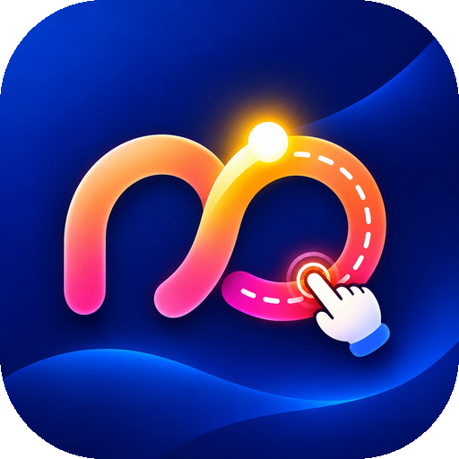

<p align="center">
  
</p>

<h1 align="center">Akkhara</h1>

<p align="center">
  <b>Learn to write the Myanmar alphabet — one letter at a time.</b>
</p>

<p align="center">
  <a href="https://akkhara.vercel.app">Website</a> ·
  <a href="https://akkhara.vercel.app/privacy">Privacy</a> ·
  <a href="https://akkhara.vercel.app/support">Support</a>
</p>

<p align="center">
  <a href="https://github.com/aungthuhein2005/learn-burmese/actions/workflows/ios.yml"></a>
  
  
  
  
  <a href="https://huggingface.co/aungthuhein-dev/myanmar-handwriting"></a>
  
</p>

---

**Akkhara** (အက္ခရာ, "alphabet") is an iPhone and iPad app that helps beginners
and children learn to **write** the 33 Myanmar consonants. A child hears a
letter, traces or writes it with a finger or Apple Pencil, and gets 0–3 stars
with friendly spoken encouragement.

Handwriting is checked **entirely on the device** by the
[`aungthuhein-dev/myanmar-handwriting`](https://huggingface.co/aungthuhein-dev/myanmar-handwriting)
model running on ONNX Runtime. Drawings never leave the phone, and the app has
no ads, accounts or tracking.

### Features

- **Learn**: swipe through all 33 letters and hear each one, recorded by a native speaker
- **Practice**: pick a letter from a grid grouped in its traditional rows, then write over a faint guide letter to get a star score
- **Quiz**: hear a letter, then write it from memory, 10 rounds
- **My Stars**: a progress board showing the best score for every letter
- **Parents' Corner**: behind a simple adult gate, with difficulty, sound and tracing-guide settings
- Works offline and supports Apple Pencil on iPad

See [DESIGN.md](DESIGN.md) for the screen list, wireframes and scoring design.

### How it's built

No Mac is needed. GitHub Actions generates the Xcode project with XcodeGen,
downloads and prepares the model, builds and signs the app, and uploads it to
TestFlight.

## Layout

```
project.yml                 XcodeGen spec (Xcode project is generated in CI)
scripts/prepare_model.py    Downloads the HF model, fixes the export, saves a single-file fp32 model
.github/workflows/ios.yml   build check (every push/PR) + TestFlight upload (manual run)
.github/workflows/smoke.yml launches the app on a simulator and collects crashes (manual run)
scripts/generate_voices.py  generates the praise clips with Azure TTS
docs/logo.png               logo used in this README
KaGyi/App                   App entry, letter data
KaGyi/ML                    ONNX Runtime wrapper, image normalization, scoring
KaGyi/Services              App state, progress, audio
KaGyi/Views                 SwiftUI screens
KaGyi/Resources             Icon, letter voices (model is added in CI)
```

## One-time TestFlight setup

Signing is cloud-managed with an App Store Connect API key:
no certificate or provisioning profile files are needed.

1. Register the bundle ID `com.aungthuhein.kagyi` at developer.apple.com →
   Identifiers, then create the app in App Store Connect → Apps → + with it.
   (To use another ID, set a repository **variable** `BUNDLE_ID`.)
2. Add these repository secrets (Settings → Secrets and variables → Actions):

   | Secret | Value |
   |---|---|
   | `APPLE_TEAM_ID` | 10-character Team ID |
   | `APPSTORE_KEY_ID` | API key ID |
   | `APPSTORE_ISSUER_ID` | Issuer ID |
   | `APPSTORE_PRIVATE_KEY` | full text of `AuthKey_XXXXXXXXXX.p8` |

3. Actions → **iOS build & TestFlight** → **Run workflow**. The build appears in
   TestFlight after Apple finishes processing (~10–30 min). The build number is
   the workflow run number. Pushes and PRs only run the compile check.

## Voices

`KaGyi/Resources/voices/` holds:
- `letter_01.m4a` … `letter_33.m4a`: human recordings of the 33 consonants.
- `praise_0.wav` … `praise_3.wav`: encouragement after each check, generated with
  Azure Neural TTS (`my-MM-NilarNeural`).

The app plays a `.wav` clip if one exists, otherwise the `.m4a`. To replace a
sound with a new recording, drop an `.m4a` with the same name into the folder.

```bash
pip install miniaudio
python scripts/generate_voices.py --env-file path/to/azure.env           # praise clips
```

The env file holds `AZURE_SPEECH_KEY=` and `AZURE_SPEECH_REGION=`. Keep it out of git.

## Scoring notes

- Drawings and reference glyphs are both cropped, centered and scaled to the
  same framing on a `#FFFCF8` background, pen width 10 px at 224×224.
- References are rendered with iOS Myanmar fonts and embedded on first launch
  (cached afterwards).
- A drawing earns 3★ only if the target letter is the model's **closest** match
  and similarity ≥ threshold; thresholds per difficulty are in
  `KaGyi/ML/Recognizer.swift`. Tune them after trying it with real kids.
